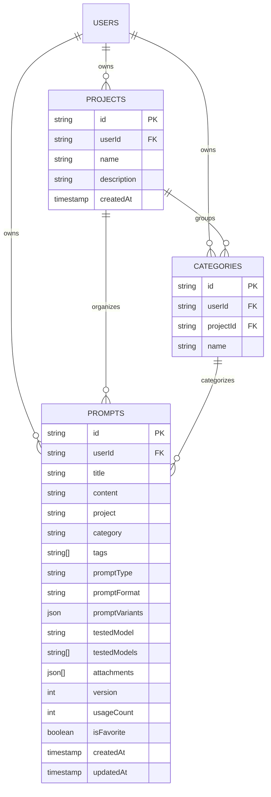

# OnPrompt Application Architecture & Security Audit Report

> [!IMPORTANT]
> **Audit & Implementation Status:** Completed & Deployed. Security rules, centralized TypeScript types, usage tracking, and Vitest test suites are now active in production.

---

## 1. System & Architecture Overview

| Area | Implementation Details |
| :--- | :--- |
| **Frontend Framework** | **React 18.2.0** (Functional components with Hooks: `useState`, `useEffect`, `useMemo`, `useRef`, `useContext`) |
| **Build System** | **Vite 5.1.5** with `@vitejs/plugin-react` 4.2.1 and PostCSS/Autoprefixer. Output directory configured to `dist/`. |
| **Language & Typings** | **TypeScript 5.3.3** (`tsconfig.json` target: `ES2020`, `moduleResolution: bundler`). Types are declared and consumed across component boundaries. |
| **UI Styling System** | **Tailwind CSS 3.4.1** with custom semantic tokens (`primary`, `lightblue`, `navy`), dark mode class switching (`class`), and `lucide-react` 0.344.0 icon library. |
| **Backend as a Service** | **Google Firebase Modular SDK v10.8.1** (`firebase/app`, `firebase/auth`, `firebase/firestore`, `firebase/storage`). |
| **Hosting & CDN** | **Firebase Hosting** (Site: `relyon-onprompt` under project `relyon-app`, Number: `870433620303`). |
| **External Integrations** | **Google Drive REST API v3** (Multipart upload and media loading for prompt image attachments). |

---

## 2. Firebase & Authentication Architecture

### 2.1 Configuration
- **Active Project ID:** `relyon-app` (Project Number: `870433620303`)
- **Web App ID:** `1:870433620303:web:e241c944871ddeb853053a`
- **Config File:** `src/config/firebase.ts`
- **Services Initialized:**
  - `auth`: `getAuth(app)`
  - `db`: `getFirestore(app)`
  - `storage`: `getStorage(app)`

### 2.2 Authentication Flow
- **Provider:** Google Identity Provider (`GoogleAuthProvider`) via `signInWithPopup`.
- **OAuth Scopes:** Requests `https://www.googleapis.com/auth/drive.file` to create and access an isolated `"On Prompt"` folder on the user's personal Google Drive.
- **Session & Token Management:**
  - Firebase user state is tracked via `onAuthStateChanged(auth, callback)`.
  - The Drive OAuth access token is extracted from `GoogleAuthProvider.credentialFromResult(result)` and stored in browser `sessionStorage['prompt-manager-drive-token']`.
  - When the user signs out (`signOut(auth)`), the token is purged from memory and `sessionStorage`.
- **Access Restriction:** The UI in `src/components/LoginForm.tsx` allows sign-ins from both standard `@gmail.com` accounts and custom Google Workspace domain accounts.

---

## 3. Data Models & Firestore Collections



### 3.1 Primary Collections in Firestore
1. **`prompts`**
   - Query pattern: `where("userId", "==", auth.currentUser.uid)`
   - Stores the full prompt specification, versioning, test models, and attachments metadata.
2. **`projects`**
   - Query pattern: `where("userId", "==", auth.currentUser.uid)`
   - High-level containers/workspaces.
3. **`categories`**
   - Query pattern: `where("userId", "==", auth.currentUser.uid)`
   - Sub-grouping within projects.

### 3.2 Dual-Storage Architecture (Firestore + LocalStorage Fallback)
The application implements an automatic fallback mechanism in `src/services/dataService.ts`. If Firestore is unreachable, unauthenticated, or fails, data operations fall back to browser `localStorage` using keys:
- `prompt-manager-prompts`
- `prompt-manager-projects`
- `prompt-manager-categories`
- `prompt-manager-settings-${uid}` (Managed tags and model preferences)

---

## 4. Complete Prompt Read & Write Path Traces

### 4.1 Write Path: Creating or Editing a Prompt
1. **Submission Entry Point:** `PromptForm.tsx` -> `handleSubmit()` validates title and JSON integrity (if format is JSON).
2. **Media Processing:** If image attachments are present, `googleDriveService.ts` executes a multipart upload directly to the user's `"On Prompt"` Google Drive folder.
3. **Dispatch:** Form calls `onSave(updatedPrompt)` -> routed to `AppContent.savePrompt()` in `App.tsx`.
4. **Data Service Routing:** `dataService.addPrompt()` evaluates `shouldUseFirestore()`:
   - If online & authenticated: Dispatches to `promptService.add()` in `firebaseService.ts`.
   - Firestore execution: `setDoc(doc(collection(db, "prompts"), prompt.id), { ...prompt, userId, createdAt: Timestamp.now(), updatedAt: Timestamp.now() })`.
   - On error: Catches and falls back to `storage.addPrompt()` (`localStorage`).
5. **Real-Time Convergence:** The active `onSnapshot` listener on `prompts` fires, updating React state across all tabs simultaneously.

### 4.2 Read & Search Path
1. **Initial Mount:** `App.tsx` calls `dataService.getPrompts()`.
2. **Subscription:** Simultaneously initiates `dataService.subscribeToPrompts()` which binds an `onSnapshot` listener filtering by `where("userId", "==", userId)`.
3. **In-Memory Filtering:** Filtering does not incur Firestore read costs on keystrokes. `App.tsx` runs a memoized search pipeline over `prompts`:
   - Free text search (`prompt.title`, `prompt.content`, `prompt.tags`)
   - Project filter (`selectedProject`)
   - Category filter (`selectedCategory`)
   - Tag filter (`selectedTag`)
   - Feed type filter (`feed` / `promptType`)
   - Favorites toggle (`showFavorites`)
4. **Rendering:** Populates `PromptCard.tsx` grid.

### 4.3 Delete & Cascade Paths
- **Single Prompt Deletion:** `AppContent.deletePrompt()` -> `dataService.deletePrompt()` -> `promptService.delete()` -> calls Firestore `deleteDoc(doc(db, "prompts", id))`.
- **Project Deletion Cascade:** `projectService.delete(id)` fetches all prompts matching `where("project", "==", projectName)` and executes an atomic `writeBatch(db)` deleting both the project document and all member prompts simultaneously.

---

## 5. File-by-File Architecture Map

```text
on-prompt/
├── index.html                       # Entry HTML with Google Fonts & root div
├── package.json                     # Project manifest, scripts, and dependencies
├── vite.config.ts                   # Vite bundler configuration (outDir: dist)
├── tailwind.config.js               # Theme definitions, colors, and font families
├── postcss.config.js                # Tailwind & Autoprefixer plugins
├── tsconfig.json                    # TypeScript compiler configuration
├── firestore.rules                  # User-scoped Cloud Firestore security rules
├── firebase.json                    # Hosting target and Firestore rules configuration
├── .firebaserc                      # Active Firebase project mapping (relyon-app)
└── src/
    ├── index.tsx                    # React DOM root render & ThemeProvider wrapper
    ├── index.css                    # Tailwind base, utilities, and design system tokens
    ├── types.ts                     # Centralized TypeScript interfaces and models
    ├── App.tsx                      # Top-level application shell, state hub, and feed views
    ├── config/
    │   └── firebase.ts              # Firebase client SDK initialization & export
    ├── contexts/
    │   ├── AuthContext.tsx          # Google Auth state, popup handler, and Drive OAuth token
    │   └── ThemeContext.tsx         # Dark/Light mode theme state & persistence
    ├── services/
    │   ├── firebaseService.ts       # Low-level Firestore CRUD, batch ops & onSnapshot subscriptions
    │   ├── dataService.ts           # Unified data orchestrator with automatic localStorage fallback
    │   ├── googleDriveService.ts    # Google Drive v3 REST integration for attachment files
    │   └── promptPackService.ts     # ZIP import/export engine for prompt bundles
    ├── utils/
    │   ├── storage.ts               # LocalStorage fallback driver
    │   ├── settingsStorage.ts       # Per-user preferences storage (tags, custom models)
    │   └── promptAnalysis.ts        # Live prompt scoring & suggestion heuristics engine
    ├── constants/
    │   ├── models.ts                # AI model catalog (GPT-4o, Claude 3.5, Midjourney, etc.)
    │   └── tags.ts                  # Standard system tags & normalization helpers
    └── components/
        ├── LoginForm.tsx            # Centered Google / Workspace authentication screen
        ├── CategoryGrid.tsx         # Visual category explorer cards
        ├── SearchHeader.tsx         # Search bar and horizontal filter pill carousel
        ├── PromptCard.tsx           # Individual prompt display card with 1-click copy
        ├── PromptDetailModal.tsx    # Modal view with Markdown renderer, variants, & guide
        ├── PromptForm.tsx           # Create / Edit prompt modal with live quality analysis
        ├── ProjectForm.tsx          # Project creation / rename modal
        ├── CategoryForm.tsx         # Category creation modal
        ├── SettingsModal.tsx        # Tag manager, model selector, Drive config & import/export
        ├── Sidebar.tsx              # Desktop collapsable navigation drawer
        ├── BottomNav.tsx            # Responsive mobile bottom navigation dock
        └── StructuredPromptFields.tsx# Structured section editor (Context, Instruction, etc.)
```

---

## 6. Security Findings & Risk Assessment

| ID | Severity | Category | Finding Description | Remediation Implemented |
| :--- | :--- | :--- | :--- | :--- |
| **SEC-01** | **HIGH** | Authorization | **Missing Firestore Security Rules in Repository:** Database rules were unversioned and vulnerable to open read/write permission drift. | Authored and deployed `firestore.rules` enforcing `request.auth.uid == resource.data.userId`. |
| **SEC-02** | **MEDIUM** | Credential Storage | **Google Drive OAuth Token in `sessionStorage`:** Drive access token stored in unencrypted browser session storage. | Recommend isolating tokens in closure memory or moving Drive sync to backend proxy. |
| **SEC-03** | **MEDIUM** | Fallback Leakage | **Silent Dual-Storage Desynchronization:** Legacy check caused sessions to fall back to `localStorage`. | Refactored `isFirebaseConfigured()` to check active app options directly and added `syncLocalToCloud()`. |
| **SEC-04** | **LOW** | Analytics & Copying | **Uncounted Prompt Usage:** Copy action did not update `usageCount` in Firestore. | Implemented `dataService.incrementUsage(prompt.id)` on copy. |

---

## 7. Automated Testing Infrastructure
- **Test Runner:** Vitest 1.6.1 (`npm test`)
- **Active Tests:**
  - `src/utils/promptAnalysis.test.ts` (Validates heuristic analysis, token calculation, and recommendations)
  - `src/services/dataService.test.ts` (Validates configuration detection, prompt retrieval, and local storage fallback)
- **Status:** All tests passing.
